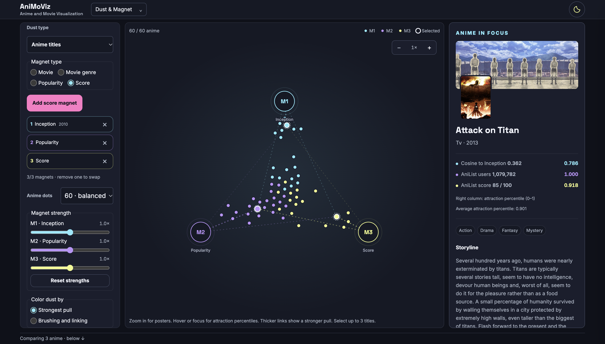
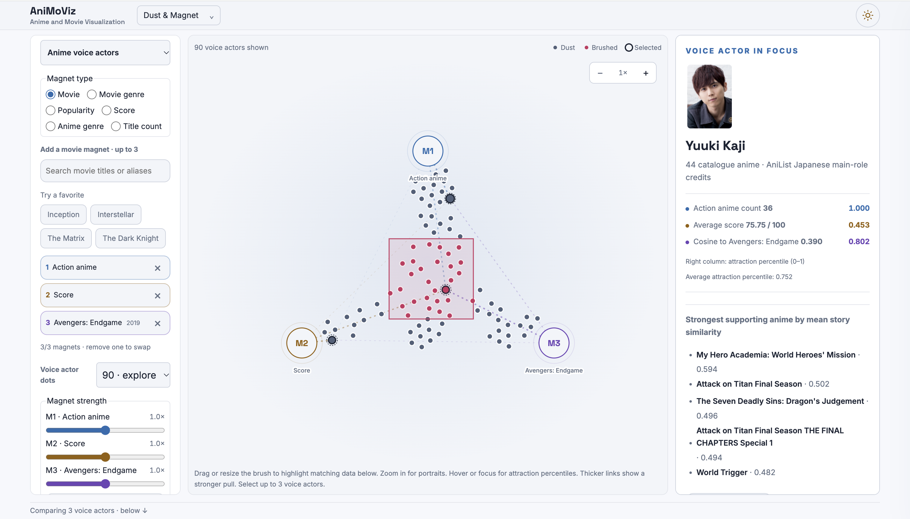
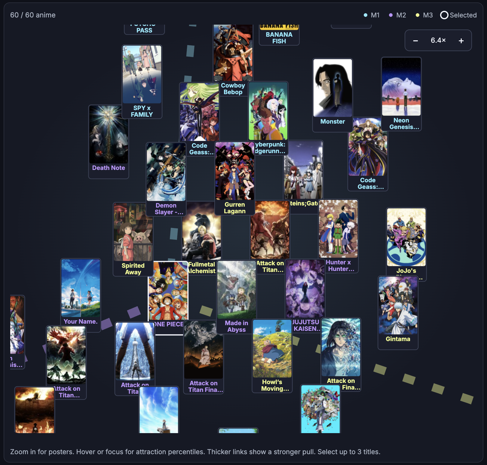
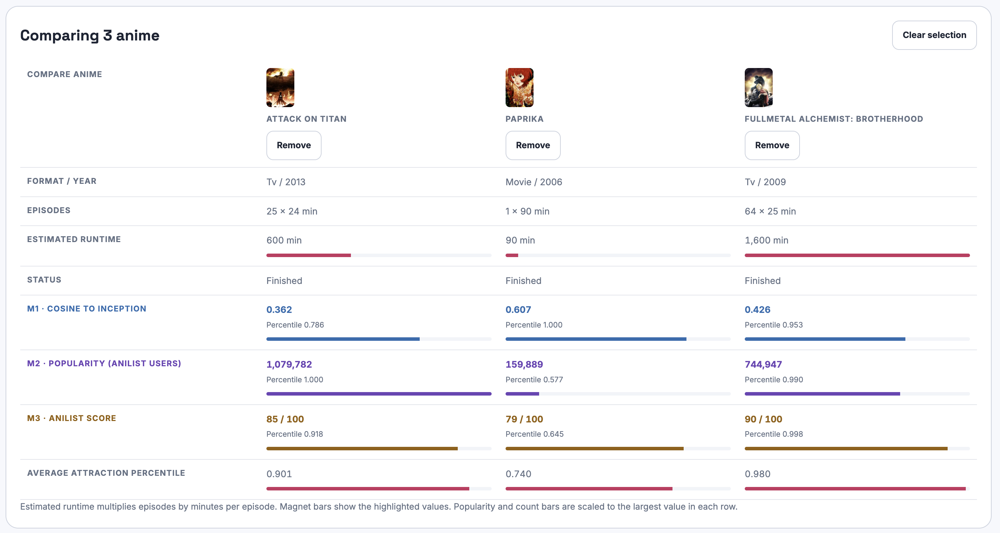
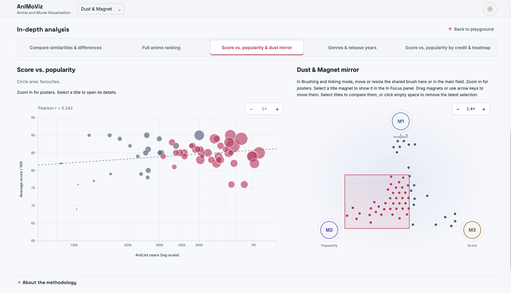
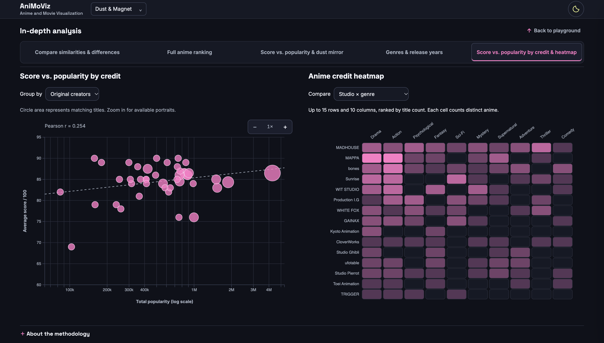
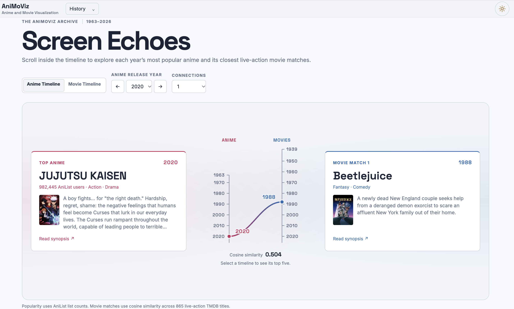
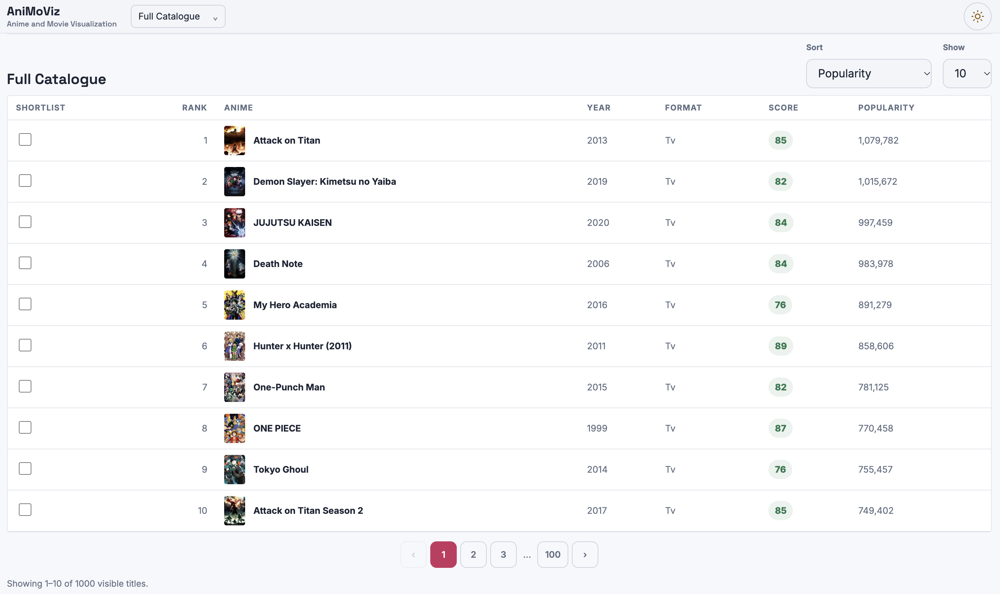

# AniMoViz

**[Open the live demo](https://alfiyandyhr.github.io/animoviz/)**

AniMoViz lets you explore story similarities between 1,000 AniList anime and 1,000 TMDB movies. Use the view menu to switch between the interactive comparison, release timelines, and searchable catalogue.

## Run locally

With Python 3.10+ installed, run this from the project root and open [http://localhost:8000](http://localhost:8000).

```bash
python3 -m http.server 8000 --bind 127.0.0.1
```

The three views use the bundled data and scores. The browser loads D3 and artwork over the internet. For the Flask server, install `backend/requirements.txt` and run `python3 backend/app.py` (default port 5000).

## Explore the three views

**Dust & Magnet** opens with Inception as a movie magnet. Add a second magnet, drag them around, or select dots to compare titles and inspect the linked charts.



<details>
<summary>More Dust &amp; Magnet screenshots</summary>











</details>

**History** connects a year's most popular anime or movie to its closest matches in the other catalogue.



**Full Catalogue** lets you search, filter, and shortlist anime or movies for comparison.



## Refresh the dataset and similarity scores

On macOS or Linux, run from the project root. Copy `data/.env.example` to `data/.env.local` and fill in `TMDB_READ_ACCESS_TOKEN` or `TMDB_API_KEY`. AniList uses its public API.

```bash
python3 -m venv .venv
source .venv/bin/activate
python -m pip install -r backend/requirements.txt -r data/semantic_similarity/requirements-embeddings.txt
python data/refresh_data.py --update-dataset
python data/refresh_data.py --recompute-scores
python data/refresh_data.py --update-dataset --anime-creator-only
```

`--update-dataset` stages the new catalogue. `--recompute-scores` downloads the model on first use, scores the catalogue locally, and updates the website files and History matches. `--anime-creator-only` refreshes credits for the new anime roster. If catalogue collection is interrupted, rerun it with `--resume`. For a smaller scoring batch, add `--batch-size 2` to `--recompute-scores`.

See the [data refresh guide](data/semantic_similarity/README.md) for the files to publish together and how to update History's annual AniList archive. Open **About the methodology** in Dust & Magnet or read the [methodology PDF](data/semantic_similarity/similarity_methodology.pdf) for how scores are computed.

Data comes from AniList and The Movie Database (TMDB). This product uses the TMDB API but is not endorsed or certified by TMDB. The [TMDB logo by Travis Bell](https://commons.wikimedia.org/wiki/File:Tmdb.new.logo.svg) is licensed under [CC BY-SA 4.0](https://creativecommons.org/licenses/by-sa/4.0/).
